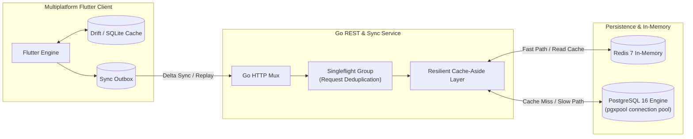
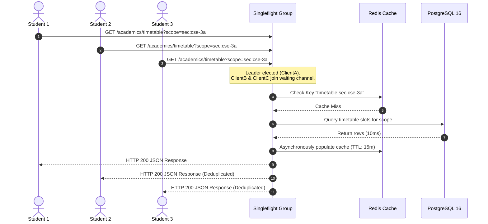
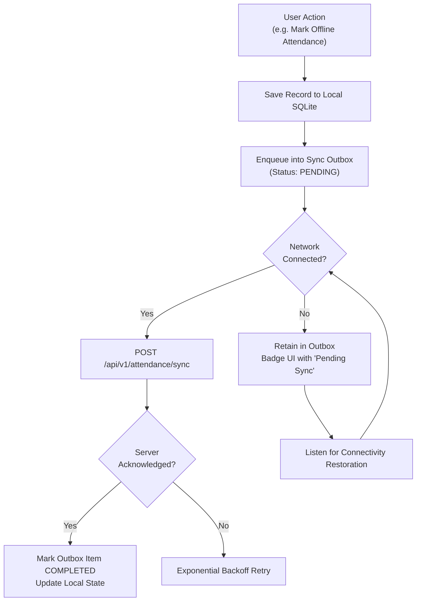
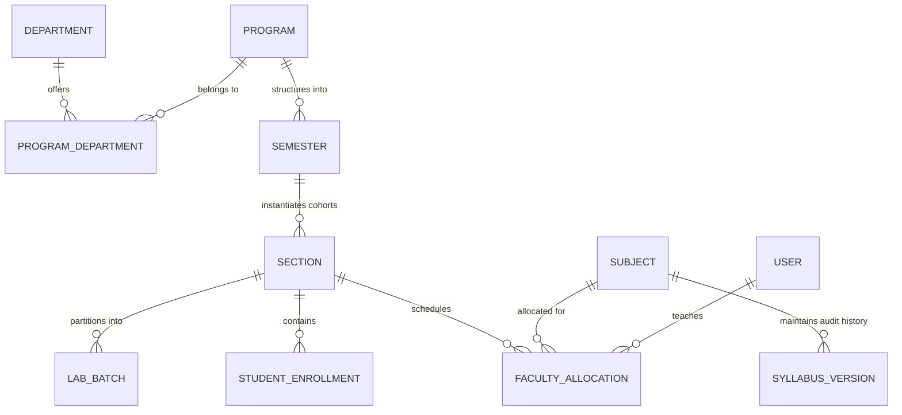

# Architecture & System Design

This document details the architectural blueprints of **CampusManagement**, focusing on resilient caching, database concurrency controls, offline-first client synchronization, and multiplatform delivery.

---

## 1. System Topology

---

## 2. Resilient Dual-Tier Caching & Singleflight

### 2.1 The Thundering Herd Problem
In a university environment, thousands of students check grades, schedules, or notices simultaneously (e.g. 09:00 AM term timetable release). A cache miss across 5,000 concurrent requests could easily saturate the database connection pool, inducing connection timeouts or cascade failures.

### 2.2 Singleflight Deduplication
The Go backend implements `golang.org/x/sync/singleflight`. When multiple concurrent goroutines request the identical cache key (e.g. `timetable:sec:cse-3a`), only **one** goroutine executes the database query. All other concurrent goroutines wait on the channel and share the result once resolved.

### 2.3 Resilient Redis Fallback
If the Redis server is unavailable, network partitioned, or restarting:
- The backend does **not** crash or fail the incoming HTTP request.
- The cache manager transparently catches Redis connection errors, logs an alert, falls back to direct PostgreSQL reads, and degrades gracefully.
- Health checks at `/api/health` expose `"cache_ready": false` without interrupting service availability.

---

## 3. Database Layer & PostgreSQL Connection Pooling

The database layer utilizes `pgxpool` with strict connection caps:
- **`MaxConns: 30`**: Protects the PostgreSQL database from unbounded connection thread spawns.
- **`MinConns: 5`**: Maintains hot connections to avoid TCP and TLS handshake overhead.
- **Prepared Statements**: Parameterized queries prevent SQL injection and allow query plan reuse.
- **Transactions (`pgx.Tx`)**: Atomic operations ensure user admission, handle creation, role assignment, and enrollment are either committed entirely or rolled back.

---

## 4. Offline-First Client Architecture

Campus networks often experience poor indoor cellular coverage and Wi-Fi dead zones in lecture halls. To provide uninterrupted operational reliability, the Flutter client employs an **offline-first outbox model**:

### 4.1 Delta Sync Protocol
When the client transitions from offline to online:
1. **Pull Step**: The client issues `GET /api/v1/sync?since=<last_synced_timestamp>`.
2. The server responds with all courses, timetable slots, attendance sessions, and notices modified since that timestamp.
3. **Reconciliation**: The client applies updates locally using idempotent upserts.
4. **Push Step**: Any locally recorded events (such as student optical verifications or manual checklist entries) in the outbox are drained via `POST /api/v1/attendance/sync`.

---

## 5. Security & Isolation Model

- **No Self-Registration**: Accounts are provisioned exclusively via institutional onboarding (`/api/v1/users/student` and `/api/v1/users/employee`).
- **Cryptographic Ephemeral Tokens**: Rapidly rolling optical attendance frames include HMAC-SHA256 signatures with 6-second lifetimes to eliminate remote screenshot proxy fraud.
- **Scope-Delimited RBAC**: Permissions are evaluated dynamically against scope hierarchies (`inst:*` > `campus:main` > `dept:cse` > `sec:cse-3a`), preventing horizontal privilege escalation across departments.

---

## 6. Academic Hierarchy, Cross-Program Cohorts & Workload Engine

The academic subsystem models complex real-world university organizational structures, cross-listed courses, student mobility, and curriculum accreditation requirements.

### 6.1 Multi-Department ($M:N$) Interdisciplinary Modeling
Traditional academic management software restricts programs and teachers to a single departmental silo. In CampusManagement:
- **Interdisciplinary Programs**: Programs (such as *Artificial Intelligence & Data Science* or *Bioinformatics*) link to multiple departments via join tables (`program_departments`).
- **Cross-Departmental Teaching**: Faculty members can be affiliated with multiple departments and take courses outside their primary home department.
- **Hierarchical Scopes**: RBAC evaluations traverse department scopes cleanly (`dept:cse`, `dept:math`).

### 6.2 Cross-Program Shared Sections & Student Cohort Mobility
Universities frequently pool students from different degree programs into common foundational lecture sections (e.g. Calculus or Environmental Science shared between BCA and B.Sc. IT).
- **Shared Cohorts**: A `Section` can have `is_shared: true` and associate with multiple `program_ids`.
- **Individual Student Mobility**: Students can be transferred between sections (`/api/v1/academics/sections/transfer-student`), automatically updating their scoped attendance privileges.
- **Cohort Consolidation (Merges)**: Low-enrollment sections can be merged into a single consolidated section (`/api/v1/academics/sections/merge`) within a single database transaction.

### 6.3 Subject Catalog & Odd/Even Term Cycle Code Aliasing
A recurring challenge in university administration is code variation across term cycles: the same subject with identical syllabus and credit weighting may be assigned code `BCA-102` during odd semesters and code `BCA-202` during even semesters or remedial cycles.
- Subjects exist as independent academic entities decoupled from rigid degree programs.
- Each subject maintains both `odd_semester_code` and `even_semester_code` alongside a default canonical catalog code.
- This prevents duplicate subject creation, fragmented grade histories, and disjoint attendance records while honoring registrar coding mandates.

### 6.4 Immutable Syllabus Revision Audit Trail
Accreditation bodies (NAAC, NBA, ABET) require proof of Board of Studies (BoS) curriculum approvals and historical syllabi.
- Every revision to a subject's syllabus creates an immutable `syllabus_versions` record containing the approval authority, revision code, change notes, effective timestamp, and full markdown syllabus content.
- The active subject points to `current_syllabus_version_id`.
- Historical versions can never be mutated or destroyed, providing a tamper-proof audit trail.

### 6.5 Practical Lab Batches & Deterministic Auto-Partitioning
Because laboratory facilities have fixed workstation limits (typically 25–30 benches), full lecture sections (60+ students) must be subdivided into practical lab batches ($B_1, B_2, \dots, B_N$).
- **Deterministic Auto-Partitioning**: Given a section with $M$ enrolled students and a requested partition count $N$, the algorithm deterministically distributes students using a round-robin assignment based on sorted student IDs / handles.
- **Manual Batch Overrides**: Administrators can selectively reassign students between batches to balance special lab equipment access.

### 6.6 Faculty Subject Allocations & Workload Tracking
The allocation engine maps faculty members to specific academic components:
- **Component Types**: `theory` (lectures), `practical` (laboratory sessions with specific batches), and `tutorial` (problem-solving groups).
- **Workload Ceiling**: Enforces institutional teaching norms with a standard 16 weekly contact hours threshold.
- **Real-Time Overload Detection**: The system calculates aggregate assigned weekly hours per faculty member (`GET /api/v1/academics/faculty/workload`) and flags overloaded faculty (`is_overloaded: true`) when allocations exceed the ceiling.
