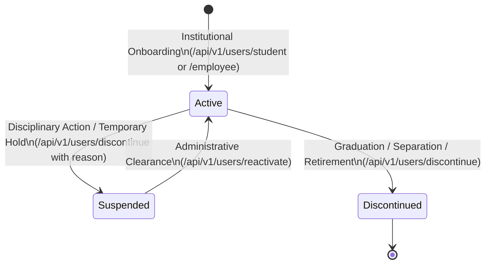

# Identity Management & Scoped RBAC

This document outlines the **Canonical Identity Minting Engine**, the **Zero-Signup Security Policy**, and the **Scoped Role-Based Access Control (RBAC)** architecture in CampusManagement.

---

## 1. Zero-Signup Institutional Security Policy

In an institutional campus operating system, public user self-registration is inherently unsafe (e.g., identity spoofing, unauthorized faculty impersonation, duplicate enrollments).

CampusManagement enforces a strict **Zero-Signup Policy**:
- There is **no public registration or sign-up endpoint**.
- All identities are created through authorized administrative onboarding via the Registrar or Academic Affairs office.
- Accounts are seeded or provisioned via `/api/v1/users/student` and `/api/v1/users/employee`.
- Authentication uses canonical campus handles or institutional email addresses with pre-provisioned credentials.

---

## 2. Canonical Handle Minting Engine (`idgen`)

To eliminate ambiguity across student roll numbers, nicknames, and departmental IDs, the system generates immutable, globally unique **Canonical Campus Handles**.

### 2.1 Student Handle Format

$$\text{Format: } \{\text{sanitized\_name}\}\_\{\text{admission\_year}\}\_\{\text{entry\_type}\}\_\{\text{program}\}\_\{\text{sequence}\}$$

- **`sanitized_name`**: Lowercase alphanumeric string with punctuation stripped (e.g., `"Harish Kumar"` $\rightarrow$ `"harish"`).
- **`admission_year`**: 4-digit admission year (e.g., `2025`).
- **`entry_type`**: Entry pathway indicator:
  - `r`: Regular admission.
  - `l`: Lateral entry (direct 2nd year entry).
  - `t`: Transfer student.
- **`program`**: Canonical academic degree code (e.g., `btech`, `mtech`, `bca`, `mca`, `phd`).
- **`sequence`**: Deterministic monotonic integer to resolve name collisions (e.g., `1`, `2`, `3`).

**Example**:
> Student: *Harish Kumar*, Lateral Entry, B.Tech, 2025 $\rightarrow$ **`harish_2025_l_btech_1`**

### 2.2 Employee Handle Format

$$\text{Format: } \{\text{sanitized\_name}\}\_\{\text{joining\_year}\}\_\text{emp}\_\{\text{sequence}\}$$

- Unified format applied across all staff: Teaching Faculty, Deans, HODs, Lab Technicians, Administrative Clerks, and Facilities Staff.

**Example**:
> Faculty: *Dr. Sharma*, Joined 2025 $\rightarrow$ **`dr_sharma_2025_emp_1`**

### 2.3 Contractor / External Vendor Handle Format

$$\text{Format: } \{\text{sanitized\_name}\}\_\{\text{onboarding\_year}\}\_\text{ext}\_\{\text{sequence}\}$$

- Applied across third-party outsourced personnel: Canteen / Mess operators, Facility Management & Cleaning, Security Guards, Transport & Shuttle Drivers, and Specialized Lab Maintenance Vendors.
- Linked directly with an institutional **Gate Pass ID** and **Access Scopes** (e.g. `gate:main`, `building:canteen`).

**Example**:
> Contractor: *Mukesh Verma* (Sodexo Dining), Onboarded 2025 $\rightarrow$ **`mukesh_2025_ext_1`**

### 2.4 Deterministic Sequence Allocation & Concurrency
The `idgen` service handles concurrency via atomic database sequence counters or database table locking. If two students named "Rahul Sharma" are admitted concurrently in the same academic intake, the sequence allocator assigns sequence `1` and `2` with zero race conditions.

---

## 3. Scoped Role-Based Access Control (RBAC)

Traditional flat roles (such as `"Admin"` or `"Faculty"`) are inadequate for universities because authority is inherently localized (e.g., a Professor can record attendance for Section CSE-3A, but cannot approve course grades for Electrical Engineering).

### 3.1 Scope Hierarchy Structure

Scopes are colon-delimited hierarchical strings:

```
inst:*                       (Institutional root authority)
└── campus:main              (Main campus administrative zone)
    └── dept:cse             (Department of Computer Science)
        ├── sec:cse-3a       (Section 3A Cohort)
        └── sec:cse-3b       (Section 3B Cohort)
```

| Scope String | Effective Scope Coverage | Typical Assignee |
| :--- | :--- | :--- |
| `inst:*` | Entire institution across all campuses | Chancellor, Registrar, Central IT Superadmin |
| `campus:main` | Specific geographic campus | Campus Director, Chief of Security |
| `dept:cse` | Department-wide academic domain | Head of Department (HOD), Academic Coordinator |
| `sec:cse-3a` | Specific classroom section / lecture hall | Course Instructor, Section Class Representative |

### 3.2 Permission Evaluation Rules

When an action is evaluated (e.g., checking if user `u` has permission `attendance:record` on target resource `sec:cse-3a`):
1. **Direct Match**: User possesses `attendance:record` scoped to `sec:cse-3a`.
2. **Hierarchical Inheritance**: User possesses `attendance:record` scoped to a parent scope (`dept:cse`, `campus:main`, or `inst:*`).
3. **Wildcard Actions**: User possesses `attendance:*` or `*:*` at or above the requested scope.
4. **Deny by Default**: If no matching permission-scope tuple satisfies the evaluation, the request returns `HTTP 403 Forbidden`.

### 3.3 Dual-Role Employees

Employees often hold multiple overlapping responsibilities simultaneously. For example, an Associate Professor may also serve as Department Head and Chair of the Anti-Ragging Committee.

The system natively supports **Dual and Multi-Role Assignments**:
- An employee identity has a single persistent handle (`dr_sharma_2025_emp_1`).
- Roles are attached as discrete grants with individual scopes:
  - Role `faculty` with scope `sec:cse-3a` (grants `attendance:record`, `grades:enter`).
  - Role `hod` with scope `dept:cse` (grants `curriculum:approve`, `timetable:publish`, `faculty:assign`).

---

## 4. User Lifecycle Management

Identities progress through explicit lifecycle states:



### 4.1 Discontinuation & Offboarding
When a student graduates or an employee leaves the institution:
- Endpoint: `POST /api/v1/users/discontinue`
- The user's status transitions to `discontinued`.
- Active authentication tokens are invalidated immediately.
- Historical records, attendance logs, and grade transcripts are preserved for institutional audit trails.

### 4.2 Reactivation
If a suspended student completes disciplinary review or an employee returns from sabbatical, the administrator can reactivate the identity via `POST /api/v1/users/reactivate`.
