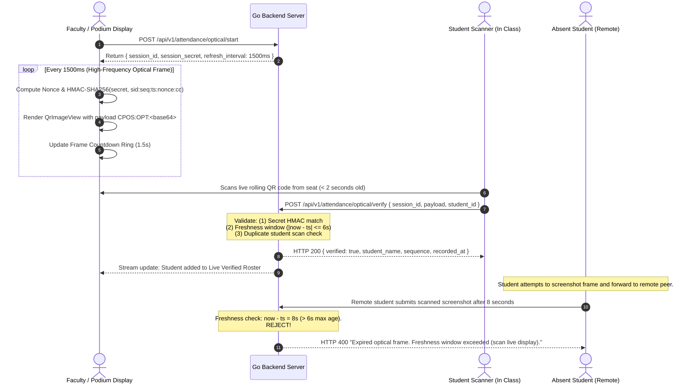

# Optical Data Transfer Attendance Protocol

This document provides a technical specification of the **Anti-Proxy Optical Attendance System** implemented in CampusManagement. It outlines how rapidly rolling ephemeral QR codes prevent proxy attendance, screenshot sharing, and replay fraud.

---

## 1. Problem Statement: Vulnerabilities of Traditional QR Attendance

Standard QR code attendance systems suffer from severe vulnerabilities:
1. **Screenshot Sharing**: A student present in class takes a screenshot of the projected QR code and sends it via messaging apps (WhatsApp, Telegram, Discord) to absent peers.
2. **Remote Proxy Attendance**: Absent students scan the forwarded image from their home or hostel and are falsely marked present.
3. **Replay Attacks**: A single captured QR code payload can be re-submitted multiple times over the course of the lecture.

---

## 2. Protocol Architecture

To eliminate these attack vectors, CampusManagement utilizes **Optical Data Transfer (ODT)** with rapidly rolling, cryptographically signed ephemeral frames.



---

## 3. Optical Frame Packet Specification

Each QR code frame contains a compact, URI-safe optical packet prefixed with `CPOS:OPT:`.

### 3.1 Raw JSON Payload Schema

```json
{
  "t": "OPT",
  "sid": "opt_c74d6f83b19e",
  "cc": "CS301",
  "cn": "Operating Systems",
  "rm": "LH-101",
  "seq": 42,
  "ts": 1730707800,
  "nc": "e3b0c442",
  "sig": "a4f89d20c15e8b4a"
}
```

| Field | Type | Description |
| :--- | :--- | :--- |
| `t` | string | Protocol type tag (`"OPT"`). |
| `sid` | string | Ephemeral optical attendance session ID. |
| `cc` | string | Canonical course code (e.g. `CS301`). |
| `cn` | string | Official course name (e.g. `Operating Systems`). |
| `rm` | string | Assigned classroom or lecture hall (e.g. `LH-101`). |
| `seq` | integer | Strictly incrementing frame sequence counter (1, 2, 3...). |
| `ts` | integer | Unix timestamp (seconds) when the optical frame was generated. |
| `nc` | string | 8-character cryptographic nonce to ensure unique frame hashes. |
| `sig` | string | 16-character truncated HMAC-SHA256 signature. |

### 3.2 Wire Encoding

The raw JSON payload is UTF-8 encoded and Base64URL-encoded (RFC 4648 without padding), then appended to the optical prefix:

```
CPOS:OPT:eyJ0IjoiT1BUIiwic2lkIjoib3B0X2M3NGQ2ZjgzYjE5ZSIsImNjIjoiQ1MzMDEiLCJjbiI6Ik9wZXJhdGluZyBTeXN0ZW1zIiwicm0iOiJMSC0xMDEiLCJzZXEiOjQyLCJ0cyI6MTczMDcwNzgwMCwibmMiOiJlM2IwYzQ0MiIsInNpZyI6ImE0Zjg5ZDIwYzE1ZThiNGEifQ
```

Keeping the wire length under **150 characters** ensures high data density and low error-correction overhead, allowing mobile cameras to decode the rolling QR in under 80 milliseconds.

---

## 4. Cryptographic Integrity & Anti-Proxy Constraints

### 4.1 HMAC-SHA256 Signature Generation
At session initialization, the server generates a cryptographically random 256-bit `session_secret`. Each rolling frame calculates:

$$\text{Data} = \text{session\_id} \parallel \text{":"} \parallel \text{sequence} \parallel \text{":"} \parallel \text{timestamp} \parallel \text{":"} \parallel \text{nonce} \parallel \text{":"} \parallel \text{course\_code}$$

$$\text{Signature} = \text{Hex}(\text{HMAC-SHA256}(\text{session\_secret}, \text{Data}))[0 \dots 16]$$

This guarantees that:
- Frames cannot be forged by students without knowing the ephemeral `session_secret`.
- Modifying the timestamp or sequence invalidates the signature.

### 4.2 Strict Freshness Window (6-Second Lifespan)
Upon receiving a verification request, the server and local verification engine evaluate:

$$\Delta t = t_{\text{server}} - t_{\text{frame}}$$

- **Valid Condition**: $-2 \le \Delta t \le 6 \text{ seconds}$.
- **Rejection**: If $\Delta t > 6$, the request is rejected with:
  > `"Expired optical frame (age: Xs, max: 6s). Students must scan directly from the podium display."`

Because forwarding a photo or screenshot over messaging channels and opening it on a second device takes more than 6 seconds in real-world conditions, remote proxy attempts are completely neutralized.

### 4.3 Idempotency & Duplicate Rejection
The backend and local storage maintain a verified student registry for the active session. If a student attempts to scan multiple frames during the same session, subsequent scans are recognized as already marked and return the verified receipt without duplicating attendance records.

---

## 5. User Interface & Hardware Telemetry

### 5.1 Podium Broadcaster (Faculty Display)
- **High-Frequency Refresh**: Timer ticks every `1500ms`, recalculating nonce, signature, sequence, and repainting the QR matrix.
- **Progress Ring**: Animated circular progress ring visually communicates countdown time remaining for the active frame.
- **Security Notice**: Alerts the lecture hall that screenshots expire in 6 seconds.
- **Live Reconciliation Roster**: Displays a live feed of verified students with their canonical handle, name, and sequence number.
- **Stream Controls**: Dedicated `Pause Stream` and `Conclude & Save` buttons.

### 5.2 Receiver Scanner (Student Mobile / Device)
- **Targeting Reticle**: High-contrast scanning frame with smooth laser sweep animation (`ALIGN RETICLE WITH CLASSROOM DISPLAY`).
- **Cross-Platform Camera Pipeline**:
  - **Android / iOS / macOS**: Hardware camera stream accelerated via AVFoundation / Google ML Kit with platform permissions (`NSCameraUsageDescription`, `android.permission.CAMERA`).
  - **Web**: HTML5 `<video>` camera stream via browser `mediaDevices.getUserMedia` with fallback error boundaries.
  - **Linux Desktop**: Direct V4L2 zero-copy hardware MJPEG passthrough via `ffmpeg -input_format mjpeg -c:v copy` with backward-scanning stale frame dropping to guarantee zero-lag live preview. Background decoding via `zbarimg`.
- **Instant Decoding**: Decodes the optical URI prefix immediately without blocking UI repaint loops.
- **Visual Feedback**: Displays a green verified confirmation badge with the recorded sequence, course code, student handle, and server timestamp.
- **Standardized Error Handling**: Optical errors map directly to mild, non-technical error notifications (`CPOS-CAM-101` through `CPOS-CAM-104`, `CPOS-OPT-201` through `CPOS-OPT-204`). Detailed resolution procedures are documented in [Error Catalog](ERROR_CATALOG.md).

---

## 6. Offline Optical Verification Mode

When the lecture hall lacks internet connectivity:
1. The faculty broadcaster operates the optical broadcast using the local application storage.
2. The student's device verifies the optical frame signature against cached session parameters and appends the attendance record to the **Sync Outbox**.
3. Once the student or faculty device reconnects to Wi-Fi/cellular, the outbox drains all attendance proofs to `/api/v1/attendance/sync` for automated delta reconciliation.
