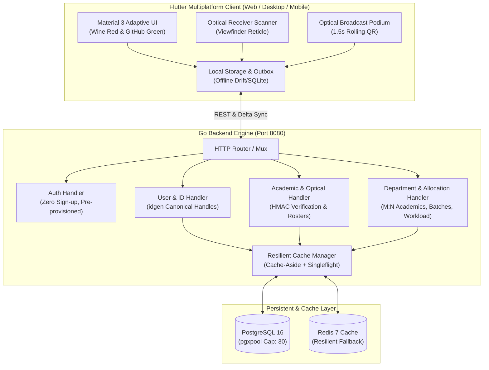

# CampusManagement Documentation Portal

Welcome to the **CampusManagement** engineering documentation. This repository houses the cross-platform campus operating system built with a **Flutter** multiplatform client, a high-throughput **Go** backend, **PostgreSQL 16**, **Redis** cache-aside with `singleflight` deduplication, and an **anti-proxy optical data transfer attendance engine**.

---

## Documentation Index

| Guide | Description |
| :--- | :--- |
| [Architecture & System Design](ARCHITECTURE.md) | High-level system topology, caching strategy, offline-first Drift/SQLite outbox, and delta sync replication. |
| [Optical Attendance Protocol](OPTICAL_ATTENDANCE.md) | Deep dive into rolling QR codes, 1.5s ephemeral frame turnovers, HMAC-SHA256 signatures, and anti-proxy mitigations. |
| [Identity & Scoped RBAC](IDENTITY_AND_RBAC.md) | Canonical handle generation (`idgen`), scoped roles, dual-role employees, and user lifecycle states. |
| [API Reference](API_REFERENCE.md) | Comprehensive REST API specification with request/response schemas, error handling, and cURL examples including Fee, Fine, Library, Dispute, AKTU Sessional Hub, and DigiLocker subsystems. |
| [UI & Design System](UI_AND_DESIGN_SYSTEM.md) | Wine Red & GitHub Green palette, smooth theme transitions, SVG icons, desktop dropdowns, lighter placeholder standards, and non-scrollable viewports. |
| [Error Catalog & Troubleshooting](ERROR_CATALOG.md) | Institutional error catalog mapping mild user-facing error messages and reference codes (`CPOS-...`) to IT resolution steps. |
| [Operations & CLI Orchestrator](OPERATIONS_AND_SCRIPTS.md) | Universal lifecycle commands (`./script.sh`), Docker local environment, testing, and deployment. |

---

## System Overview



---

## Quick Start

```bash
# 1. Install all dependencies (Go modules & Flutter packages)
./script.sh deps

# 2. Boot PostgreSQL 16 & Redis infrastructure
./script.sh envi

# 3. Start Go backend development server
./script.sh dev

# 4. Launch Flutter client
./script.sh app run    # Native Linux Desktop
./script.sh app web    # Google Chrome

# 5. Run static analysis & test suites
./script.sh check
./script.sh test
```
